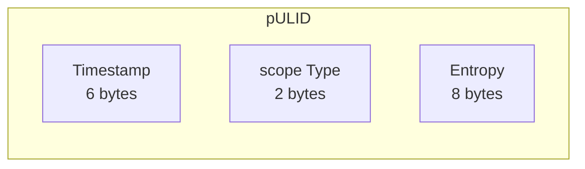

# ulid-go

pULID for Go: a 128-bit, time-sortable identifier that is both a valid ULID and a valid UUID, with two bytes reserved for a **scope** such as the entity type or tenant.

[](https://pkg.go.dev/github.com/pixie-sh/ulid-go)
[](LICENSE)

Made by [Pixie](https://pixie.sh). Project page: <https://pixie-sh.github.io/ulid-go/>. JavaScript port: [ulid-js](https://github.com/pixie-sh/ulid-js).

## Install

```sh
go get github.com/pixie-sh/ulid-go
```

The package name is `pulid`.

## Quick start

```go
package main

import (
	"fmt"
	"time"

	pulid "github.com/pixie-sh/ulid-go"
)

const (
	ScopeUser  pulid.Scope = 1
	ScopeOrder pulid.Scope = 2
)

func main() {
	id := pulid.MustNewScoped(ScopeOrder)

	fmt.Println(id.String()) // 01M7DFAH9J00108T5TB1A2837M
	fmt.Println(id.UUID())   // 01a1daf5-4532-0002-0468-ba5854240cf4

	scope, _ := id.Scope()
	fmt.Println(scope) // 2

	fmt.Println(time.UnixMilli(int64(id.Epoch())).UTC()) // when it was created
}
```

The same 16 bytes print as a 26-character ULID or as a UUID, so the ID can live in a `uuid` column and still sort by creation time. The scope tells you what kind of thing an ID points to without a database lookup.

## Usage

### Creating IDs

```go
id, err := pulid.New()                  // scope is pulid.MaxScopeValue (65535)
id, err := pulid.NewScoped(ScopeOrder)  // your own scope
id := pulid.MustNew()                   // panics on error
id := pulid.MustNewScoped(ScopeOrder)
```

Scopes `1` to `65534` are yours to assign. `0` and `65535` are reserved by the library; passing `0` to `NewScoped` yields `65535`.

Every constructor accepts an optional `io.Reader` as the entropy source. The default is `crypto/rand`.

### Parsing

```go
id, err := pulid.UnmarshalString("01M7DFAH9J00108T5TB1A2837M")
id, err := pulid.UnmarshalUUID("01a1daf5-4532-0002-0468-ba5854240cf4")
id, err := pulid.UnmarshalBytes(raw) // 16 bytes
id, err := pulid.UnmarshalUint64(n)
```

Invalid input returns an [errors-go](https://github.com/pixie-sh/errors-go) error, for example `InvalidSizeULIDSystemErrorCode-90412 invalid data size`.

### Reading an ID

| Method | Returns |
| --- | --- |
| `String()`, `ULID()`, `EncodeString()` | the 26-character ULID |
| `UUID()`, `EncodeUUID()` | the UUID string |
| `Scope()` | the scope stored in bytes 7 and 8 |
| `Epoch()` | creation time in Unix milliseconds |
| `Bytes()`, `MarshalBinary()` | the 16 raw bytes |
| `MarshallUint64()` | a 64-bit form of the ID |

`fmt` prints the ULID for `%s` and a detailed form for `%v`:

```go
fmt.Printf("%s\n", id) // 01M7DFAH9J00108T5TB1A2837M
fmt.Printf("%v\n", id) // 01M7DFAH9J00108T5TB1A2837M(epoch=1794674869554;scope=2)
```

### JSON

`ULID` implements `encoding.TextMarshaler` and `encoding.TextUnmarshaler`, so it can be used directly in structs.

```go
type Order struct {
	ID pulid.ULID `json:"id"`
}

b, _ := json.Marshal(Order{ID: id}) // {"id":"01M7DFAH9J00108T5TB1A2837M"}
```

### Databases

`ULID` implements `sql.Scanner` and `driver.Valuer`, so it can be used as a field or argument with `database/sql`. `Value` writes the 16 raw bytes; `Scan` reads either 16 bytes or a UUID string, which is what a `uuid` column returns.

```go
var id pulid.ULID
err := db.QueryRowContext(ctx, "SELECT id FROM orders WHERE number = $1", 1001).Scan(&id)
```

Driver-specific helpers for pgx and GORM are planned.

[`uuid_to_ulid_pg16.sql`](uuid_to_ulid_pg16.sql) adds a PostgreSQL 16+ function, `uuid_to_ulid(uuid)`, that returns the ULID string for a stored ID. It is handy when reading the table by hand:

```sql
SELECT uuid_to_ulid(id), * FROM orders ORDER BY id DESC LIMIT 10;
```

### Checking the scope

```go
func requireOrderID(id pulid.ULID) error {
	scope, err := id.Scope()
	if err != nil {
		return err
	}
	if scope != ScopeOrder {
		return fmt.Errorf("expected an order id, got scope %d", scope)
	}
	return nil
}
```

`pulid.EmptyUID` is the zero value, useful for "no ID" comparisons.

## What is a pULID?

- ULID compatible
- UUIDv4 compatible
- Time based
- with entropy abstraction optimized
- scope bytes can be used to store relevant information - such as entities types or namespaces
- scope 65535 and 0 are protected and used within th lib

## What different on ours? 
- Use of 7th and 8th byte to store scope type
- 2^{16} = 65536 - 2 = 65534 scope types available
- entropy used allows for concurrent calls
- uuid v4 compatible

## pULID Structure
```
  6bytes   2bytes    8bytes
| ------ | | -- | | -------- |
   epoch.  scope   entropy
```
### Structure:


### pULID strings example: 
```
for MaxScopeValue - 65535:

UUID: 0194AA0E-DCDE-FFFF-53F2-18257F60B037
ULID: 01JJN0XQ6YZZZN7WGR4NZP1C1Q
TS: 2025-01-27T23:18:08.350Z

UUID: 0194AA16-4A77-FFFF-4937-5547C5791AB7
ULID: 01JJN1CJKQZZZMJDTN8Z2QJ6NQ
TS: 2025-01-27T23:26:15.159Z
```
```
for Scope value 567

UUID: 0194AA15-34AB-0237-22E7-0B92B8C5F1B7
ULID: 01JJN1AD5B08VJ5SRBJAWCBWDQ
TS: 2025-01-27T23:25:04.043Z

UUID: 0194AA16-4A77-0237-42A9-56B6A8CBF3FF
ULID: 01JJN1CJKQ08VM5AAPPTMCQWZZ
TS: 2025-01-27T23:26:15.159Z
```

## Benchmark
```
goos: darwin
goarch: arm64
pkg: github.com/pixie-sh/ulid-go
cpu: Apple M3 Max
BenchmarkNanoIDGeneration-16         	 4081274	       288.0 ns/op
BenchmarkAnotherULIDGeneration
BenchmarkAnotherULIDGeneration-16    	 9510402	       125.9 ns/op
BenchmarkpULIDGeneration
BenchmarkpULIDGeneration-16           	 8371111	       139.2 ns/op
BenchmarkUUIDGeneration 
BenchmarkUUIDGeneration-16           	 4945442	       246.9 ns/op
PASS
```

### Thank you
- github.com/google/uuid
- github.com/matoous/go-nanoid/v2
- github.com/oklog/ulid
- github.com/RobThree/NUlid
- github.com/segmentio/ksuid

## License

[MIT](LICENSE)
